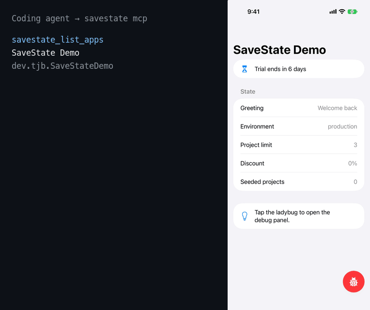

# SaveState

Declare your app's debug state once. Reach it from an in-app overlay, coding
agents, UI tests, and SwiftUI previews.

SaveState is a Swift package for iOS apps. You declare controls (premium status,
backend environment, a clock override), actions (seed data, reset onboarding),
and named **scenarios** that set many of them at once, such as `expired-trial` or
`power-user`. SaveState renders that registry as a debug overlay for people and
serves it over MCP for agents, in Debug builds only.



The demo app driven by the real `savestate mcp` server. The left side shows each
tool call with a shortened result.

> **Status:** pre-alpha, with no tagged release yet. The registry, clock, overlay,
> simulator endpoint, and MCP tools are in place for v0.1. APIs will change.

## Why

Coding agents can now build, launch, and tap through an iOS app, but they still
can't put it into a specific state without walking the UI there, and some states,
like a trial that expired yesterday, can't be reached through the UI at all.
SaveState gives every state a name and a reproducible path.

## Installation

Add the package in Xcode (File > Add Package Dependencies), or in `Package.swift`.
There's no tagged release yet, so pin to a branch for now:

```swift
.package(url: "https://github.com/tjb/SaveState", branch: "main")
```

Then add the products your app target uses:

```swift
.product(name: "SaveState", package: "SaveState"),
.product(name: "SaveStateUI", package: "SaveState"),
.product(name: "SaveStateAgent", package: "SaveState")
```

`SaveState` is the registry, `SaveStateUI` is the overlay, and `SaveStateAgent` is
the endpoint coding agents connect to. The package has no third-party dependencies.

## Declaring state

Bind controls to the model that holds your debug state, then name the
scenarios you reach for most:

```swift
import SaveState

@MainActor @Observable
final class DebugState {
    var premiumOverride: Bool?
    var environment = ServerEnvironment.production
}

let registry = SaveStateRegistry(model: debugState) { r in
    r.section("Purchases") {
        r.triState("Premium", key: "premium", \.premiumOverride, real: { store.isEntitled })
    }
    r.choice("Environment", key: "env", \.environment, requiresRelaunch: true)
    r.clock()
    r.action("Reset onboarding", key: "reset-onboarding", destructive: true) {
        onboarding.reset()
    }
    r.scenario(
        "Expired trial",
        key: "expired-trial",
        summary: "The trial ended yesterday, so the paywall shows."
    ) { state in
        state.premiumOverride = false
        SaveStateClock.overrideDate = .now.addingTimeInterval(8 * 86_400)
    }
}

try await registry.applyScenario("expired-trial")
```

Keys such as `premium` and `expired-trial` are stable identifiers that agents
and tests use. Labels are display text and can change freely.

The registry is enabled in Debug builds by default and throws
`SaveStateError.disabled` on every change otherwise. Pass `isEnabled:` to turn
it on for QA or TestFlight builds.

### The overlay

Attach the overlay at your app's root to get a floating ladybug button that
opens a panel of every control, action, and scenario:

```swift
import SaveStateUI

ContentView()
    .saveStateOverlay(registry)
```

It shows nothing when the registry is disabled. Destructive actions ask first.
[`Examples/SaveStateDemo`](Examples/SaveStateDemo) is a small app you can run.

### The agent endpoint

Start the endpoint at launch so the `savestate` bridge can reach the registry. It
exists only in Debug builds, so guard both the import and the call:

```swift
#if DEBUG
import SaveStateAgent
#endif

#if DEBUG
Task { try? await AgentEndpoint.start(registry: registry) }
#endif
```

It runs in the simulator, on the loopback interface, and each connection must
present a token that's new at each launch. Nothing listens on a physical device,
so agents can only reach apps running in the simulator.

### Connecting an agent

Clone this repository and build the bridge, then add `savestate mcp` to your agent
as a stdio MCP server. Run this from the repository's root:

```bash
(cd CLI && swift build -c release)
claude mcp add savestate -- "$PWD/CLI/.build/release/savestate" mcp
```

With a Debug build of your app running in a booted simulator, the agent gets
`savestate_list_apps`, `savestate_describe`, `savestate_set`,
`savestate_run_action`, `savestate_apply_scenario`, and `savestate_read`.
Destructive actions are refused, so a person has to run those.

### Coming from PremiumToggle

`SaveStateUI` includes PremiumToggle's API, so an existing
`.premiumToggle(manager)` keeps working after you change the import. Your
provider still owns the override and stores it under the same key, so existing
overrides carry over. The panel is SaveState's, so it offers On, Off, and Real,
and its accessibility identifiers change. `premiumToggle.button` stays the same.

### Time travel

Read `SaveStateClock.now` instead of `Date()` wherever "now" decides behavior,
such as trial expiry or streaks. The `clock()` control and scenarios can then
move the app's clock, and time keeps running from the new date. With no
override, `SaveStateClock.now` is `Date()`. A persisted override restarts from
its date at each launch, so every launch begins in the same state.

### What survives a relaunch

Changes last for the current launch unless you pass `persist: true`. A change
to a control declared `requiresRelaunch` lasts through the next launch, so
relaunching applies it once. The overlay persists its changes; agents choose.

## Packages

- `SaveState`, `SaveStateUI`, `SaveStateAgent`, `SaveStateProtocol`: the
  app-facing Swift package, with no third-party dependencies.
- `savestate`: a Mac CLI and MCP server for coding agents, in `CLI/`. It will
  install with `brew install tjb/tap/savestate` once v0.1 ships.

## Requirements

- iOS 18+ / macOS 15+
- Swift 6.2+ (Xcode 26+)

## Contributing and security

See [CONTRIBUTING.md](CONTRIBUTING.md) to work on SaveState and
[CHANGELOG.md](CHANGELOG.md) for what's changed. Report vulnerabilities privately,
as [SECURITY.md](SECURITY.md) describes.

## License

SaveState is available under the MIT license. See [LICENSE](LICENSE).
