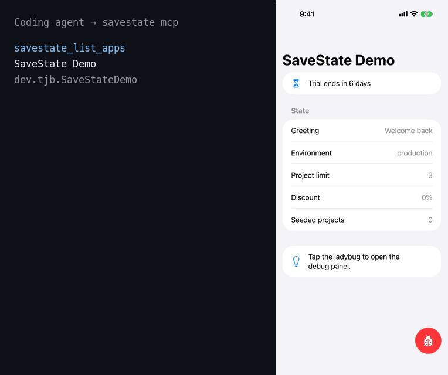

# SaveState

Declare your app's debug state once. Reach it from an in-app overlay, coding
agents, UI tests, and SwiftUI previews.

SaveState is a Swift package for iOS apps. You declare controls (premium status,
backend environment, a clock override), actions (seed data, reset onboarding),
**probes** that report read-only state (pending uploads, whether it's connected),
and named **scenarios** that set many controls at once, such as `expired-trial` or
`power-user`. SaveState renders that registry as a debug overlay for people and
serves it over MCP for agents, in Debug builds only.



The demo app driven by the real `savestate mcp` server. The left side shows each
tool call with a shortened result.

> **Status:** v0.2, an early release. It adds probes, `savestate_wait`, and a public
> client for Mac tools. APIs can change before 1.0.

## Why

Coding agents can now build, launch, and tap through an iOS app, but they still
can't put it into a specific state without walking the UI there, and some states,
like a trial that expired yesterday, can't be reached through the UI at all.
SaveState gives every state a name and a reproducible path.

## Installation

Add the package in Xcode (File > Add Package Dependencies), or in `Package.swift`:

```swift
.package(url: "https://github.com/tjb/SaveState", from: "0.2.0")
```

Then add the products your app target uses:

```swift
.product(name: "SaveState", package: "SaveState"),
.product(name: "SaveStateUI", package: "SaveState"),
.product(name: "SaveStateAgent", package: "SaveState")
```

`SaveState` is the registry, `SaveStateUI` is the overlay, and `SaveStateAgent` is
the endpoint coding agents connect to. The package has no third-party dependencies.

## Declaring state

Bind controls to the model that holds your debug state, then name the
scenarios you reach for most:

```swift
import SaveState

@MainActor @Observable
final class DebugState {
    var premiumOverride: Bool?
    var environment = ServerEnvironment.production
}

let registry = SaveStateRegistry(model: debugState) { r in
    r.section("Purchases") {
        r.triState("Premium", key: "premium", \.premiumOverride, real: { store.isEntitled })
    }
    r.choice("Environment", key: "env", \.environment, requiresRelaunch: true)
    r.clock()
    r.action("Reset onboarding", key: "reset-onboarding", destructive: true) {
        onboarding.reset()
    }
    r.scenario(
        "Expired trial",
        key: "expired-trial",
        summary: "The trial ended yesterday, so the paywall shows."
    ) { state in
        state.premiumOverride = false
        SaveStateClock.overrideDate = .now.addingTimeInterval(8 * 86_400)
    }
}

try await registry.applyScenario("expired-trial")
```

Probes report state the app owns, such as
`r.probe("Pending uploads", key: "pending-uploads") { uploads.count }`, for
Bool, Int, Double, String, and Date values. Agents read them and wait on them.

Keys such as `premium` and `expired-trial` are stable identifiers that agents
and tests use. Labels are display text and can change freely.

The registry is enabled in Debug builds by default and throws
`SaveStateError.disabled` on every change otherwise. Pass `isEnabled:` to turn
it on for QA or TestFlight builds.

### The overlay

Attach the overlay at your app's root to get a floating ladybug button that
opens a panel of every control, probe, action, and scenario:

```swift
import SaveStateUI

ContentView()
    .saveStateOverlay(registry)
```

It shows nothing when the registry is disabled. Destructive actions ask first.
Probes appear read-only under Probes. One that reads an `@Observable` model
updates live; any other shows its new value when the panel next redraws.
[`Examples/SaveStateDemo`](Examples/SaveStateDemo) is a small app you can run.

### The agent endpoint

Start the endpoint at launch so the `savestate` bridge can reach the registry. It
exists only in Debug builds, so guard both the import and the call:

```swift
#if DEBUG
import SaveStateAgent
#endif

#if DEBUG
Task { try? await AgentEndpoint.start(registry: registry) }
#endif
```

It runs in the simulator, on the loopback interface, and each connection must
present a token that's new at each launch. Nothing listens on a physical device,
so agents can only reach apps running in the simulator.

### Connecting an agent

Clone this repository and build the bridge, then add `savestate mcp` to your agent
as a stdio MCP server. Run this from the repository's root:

```bash
(cd CLI && swift build -c release)
claude mcp add savestate -- "$PWD/CLI/.build/release/savestate" mcp
```

With a Debug build of your app running in a booted simulator, the agent gets
`savestate_list_apps`, `savestate_describe`, `savestate_set`,
`savestate_run_action`, `savestate_apply_scenario`, `savestate_read`, and
`savestate_wait`. `savestate_read` reads a control or a probe by key, and
`savestate_wait` waits up to 30 seconds for a probe to meet a condition.
Destructive actions are refused, so a person has to run those.

### Coming from PremiumToggle

`SaveStateUI` includes PremiumToggle's API, so an existing
`.premiumToggle(manager)` keeps working after you change the import. Your
provider still owns the override and stores it under the same key, so existing
overrides carry over. The panel is SaveState's, so it offers On, Off, and Real,
and its accessibility identifiers change. `premiumToggle.button` stays the same.

### Time travel

Read `SaveStateClock.now` instead of `Date()` wherever "now" decides behavior,
such as trial expiry or streaks. The `clock()` control and scenarios can then
move the app's clock, and time keeps running from the new date. With no
override, `SaveStateClock.now` is `Date()`. A persisted override restarts from
its date at each launch, so every launch begins in the same state.

### What survives a relaunch

Changes last for the current launch unless you pass `persist: true`. A change
to a control declared `requiresRelaunch` lasts through the next launch, so
relaunching applies it once. The overlay persists its changes; agents choose.

## Apps on a sync engine

When your data syncs through a sync engine, agents can't see from the UI whether
a change has uploaded yet. Declare that state as probes, plus a scenario that
takes the app offline. Everything here reads or calls `syncEngine`, an object
your app already owns. **SaveState contains no sync code**: it only runs the
closures you give it.

```swift
import SaveState

@MainActor
func makeRegistry(syncEngine: SyncEngine) -> SaveStateRegistry {
    SaveStateRegistry(model: syncEngine) { r in
        r.section("Sync") {
            r.probe("Pending uploads", key: "sync.pending-uploads") {
                syncEngine.pendingUploadCount
            }
            r.probe("Connected", key: "sync.connected") {
                syncEngine.isConnected
            }
        }
        r.scenario(
            "Offline",
            key: "offline",
            summary: "The sync engine can't reach the server, so changes queue up."
        ) { _ in
            syncEngine.isSimulatingOffline = true
        }
        r.action("Go online", key: "go-online") {
            syncEngine.isSimulatingOffline = false
        }
    }
}
```

`SyncEngine` stands for your own type. This recipe assumes it has
`pendingUploadCount`, `isConnected`, and an `isSimulatingOffline` flag that
stops it from reaching the server. If your app already has a registry, add the
`Sync` section, the scenario, and the action to it instead. The closures reach
the sync engine through a capture, so they work whatever your registry's model
is.

An agent can then check that a change waits offline and uploads once the app is
back online:

1. `savestate_apply_scenario` with `key: "offline"`.
2. Make a change in the app, through the UI or an action.
3. `savestate_wait` with `key: "sync.pending-uploads"`, `condition: "atLeast"`,
   and `value: 1`.
4. `savestate_run_action` with `key: "go-online"`.
5. `savestate_wait` with `key: "sync.pending-uploads"`, `condition: "equals"`,
   and `value: 0`.
6. `savestate_wait` with `key: "sync.connected"`, `condition: "equals"`, and
   `value: true`.

Each wait returns the probe's value and `waitedMilliseconds`, or fails when the
condition isn't met within `timeoutSeconds`, which defaults to 10 and is at most
30.

If `SyncEngine` isn't `@Observable`, the probes still work. A wait checks them
every 100 ms as well as on observed changes, so it still sees the new value. The
overlay, though, shows a probe's new value only when its panel next redraws.

## Packages

- `SaveState`, `SaveStateUI`, `SaveStateAgent`, `SaveStateProtocol`: the
  app-facing Swift package, with no third-party dependencies.
- `SaveStateClientKit`: a macOS-only client for Mac tools that drive running
  apps. Add this repository's root package by URL and depend on this product.
  It compiles to nothing on iOS, and app targets shouldn't depend on it.
- `savestate`: a Mac CLI and MCP server for coding agents, in `CLI/`. Install it
  with `brew install tjb/tap/savestate`.
- `SaveStateBridgeKit`: the bridge's logic as a library, in `CLI/`, for Mac
  tools built inside this repository. It re-exports `SaveStateClientKit`.

## Requirements

- iOS 18+ / macOS 15+
- Swift 6.2+ (Xcode 26+)

Build with Xcode's toolchain. Xcode 26.6 and Xcode 27.2 are known good. The
swift.org toolchains aren't: with 6.4.2, `SaveStateClientKit`'s tests hang
([#27](https://github.com/tjb/SaveState/issues/27)), and 6.2.4 doesn't build. If
you use swiftly, `swiftly use xcode` selects Xcode's toolchain.

## Contributing and security

See [CONTRIBUTING.md](CONTRIBUTING.md) to work on SaveState and
[CHANGELOG.md](CHANGELOG.md) for what's changed. Report vulnerabilities privately,
as [SECURITY.md](SECURITY.md) describes.

## License

SaveState is available under the MIT license. See [LICENSE](LICENSE).
